<div align="center">

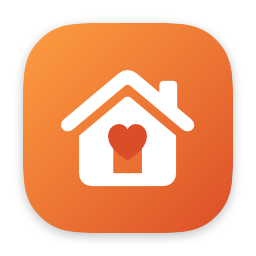

# Hearth — Simple Mac Home Screen for Seniors (Assistive Access for Mac)

### Big buttons · One-click FaceTime with family · Reminders read aloud · A Help button with scam warnings · Caregiver settings behind a PIN

**Hearth is a free, open-source app that turns a Mac into a calm, simple home for a parent or grandparent: a handful of huge buttons that a family member sets up once.**

[](https://github.com/PriyanshuGeTRekT/hearth-simple-mac-for-seniors/releases/latest)
[](https://github.com/PriyanshuGeTRekT/hearth-simple-mac-for-seniors/releases)
[](https://github.com/PriyanshuGeTRekT/hearth-simple-mac-for-seniors/stargazers)
[](https://github.com/PriyanshuGeTRekT/hearth-simple-mac-for-seniors/forks)
[](https://hits.sh/github.com/PriyanshuGeTRekT/hearth-simple-mac-for-seniors/)
[](https://github.com/PriyanshuGeTRekT/hearth-simple-mac-for-seniors/actions/workflows/build.yml)

[](https://github.com/PriyanshuGeTRekT/hearth-simple-mac-for-seniors/issues)
[](https://github.com/PriyanshuGeTRekT/hearth-simple-mac-for-seniors/commits/main)
[](LICENSE)


[](#option-2--install-with-homebrew)

[**⬇️ Download Hearth**](https://github.com/PriyanshuGeTRekT/hearth-simple-mac-for-seniors/releases/latest/download/Hearth.zip) · [Website](https://priyanshugetrekt.github.io/hearth-simple-mac-for-seniors/) · [Features](#features) · [Screenshots](#screenshots) · [Set it up](#setting-it-up-for-someone-about-10-minutes) · [FAQ](#faq)

<br>

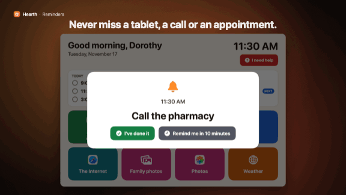

</div>

---

## What is Hearth?

Apple built **Assistive Access** for iPhone and iPad: a stripped-down interface with a few big buttons, for older people, people with cognitive disabilities, and anyone a full interface overwhelms. **The Mac has nothing like it.**

So the grown-up child, grandchild or neighbour who is "the family IT department" has no good option except to visit, and hope nothing gets clicked while they're gone.

**Hearth** is that missing piece. A family member sets it up once. After that, the person sees only this:

- **Big, plainly labelled buttons** for the people they call (one click starts a FaceTime video call), the apps they use, a few websites, and a family-photo slideshow.
- **Reminders** for tablets, appointments and calls: a big message, **read aloud**, with *I've done it* and *Remind me in 10 minutes*.
- **"I need help"**, always one click away: a call to the main helper, their number in large print, and a short **scam-safety note**.
- **A Home / Help bar that floats above every app**, so when they get lost inside Safari there is always one obvious way back.
- **Caregiver settings behind a PIN**, which you can prepare on your own Mac and send over as a setup file.

| | |
|---|---|
| 🏠 **Simple** | A handful of huge, plainly labelled buttons. Nothing to get lost in. |
| 🛡️ **Safe** | Scam warnings, an always-visible Help button, and an optional lock to the apps you chose. |
| 👀 **Readable** | Three text sizes and light, dark and high-contrast themes, sized for low vision. |
| 🔒 **Private** | No account, no cloud, no tracking, no network requests. Everything stays on the Mac. |
| 💸 **Free & open source** | MIT licensed. No subscription, ever. |

## Table of contents

- [What is Hearth?](#what-is-hearth)
- [Features](#features)
- [Screenshots](#screenshots)
- [Requirements](#requirements)
- [Installation](#installation)
- [Setting it up for someone](#setting-it-up-for-someone-about-10-minutes)
- [How the safety rules work](#how-the-safety-rules-work)
- [Privacy and safety](#privacy-and-safety)
- [Known limitations](#known-limitations)
- [FAQ](#faq)
- [Roadmap](#roadmap)
- [Contributing](#contributing)
- [License](#license)

## Features

### 🏠 A home screen with big buttons

- A warm greeting, the time and date in large print, and **today's reminders** at the top.
- **People:** one click starts a **FaceTime video** call or an audio call.
- **Apps and websites:** only the ones they actually use (Messages, Mail, Weather, a news site, the bank).
- **Family photos:** a calm full-screen slideshow from a folder you choose.
- Everything fits on **one screen**: no scrolling, no menus, no Dock needed.

### ⏰ Reminders, read aloud

- Daily or on chosen weekdays, at a set time.
- A **full-screen message** that is **read aloud**, with *I've done it* and *Remind me in 10 minutes*.
- A reminder that came due while the Mac was asleep overnight is **not shown stale** at breakfast.
- Two at once queue up politely, one after the other.

### 🆘 Help, with scam warnings

- **"I need help"** calls the main helper by video or phone, and shows their number in large print.
- A **Stay safe** card in plain words: *nobody from Apple, Microsoft or the bank phones about a computer problem; never let a stranger take control of this computer; if in doubt, call family first.*

### 🧭 Always one click home

- A small **Home / Help bar floats above every other app**.
- **Home hides the other apps; it never quits them**, so nothing is ever lost.
- Optional **strict mode**: only the apps on the home screen can come to the front. Anything else (a pop-up that opens a browser, an accidental Terminal) is sent back home with a kind sentence. **Password prompts and system alerts are never blocked.**

### 👀 Made for every eye

- **Three text sizes**: Large, Larger and Largest.
- **Light, dark and high-contrast** themes.
- Big targets, plain words, no icons without labels.

### 🧑‍💻 For the caregiver

- People, buttons, reminders, text size and a PIN in one **settings window**, behind the PIN (**⌘,**).
- **Setup files:** prepare everything on your own Mac and send it. **The PIN never travels in the file**, and every entry is checked on import: unsafe links (`javascript:`, `file:`), junk numbers and over-long values are dropped and reported.
- **Open at login**, fill the screen, strict mode. Quitting Hearth needs the PIN, so it can't be closed by accident.

## Screenshots

| Home | Reminder | Help |
|:---:|:---:|:---:|
| 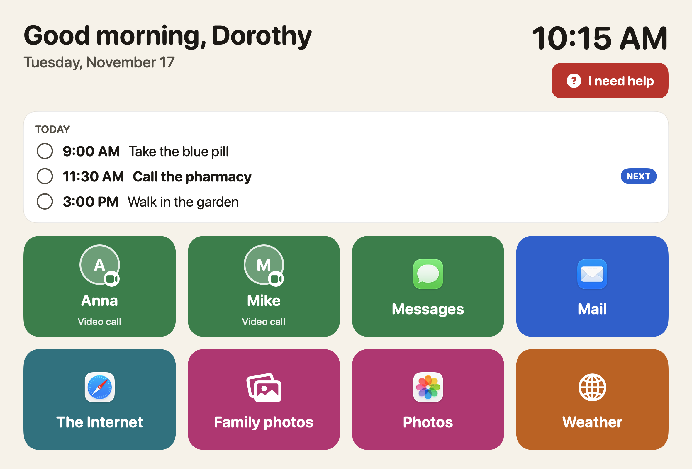 | 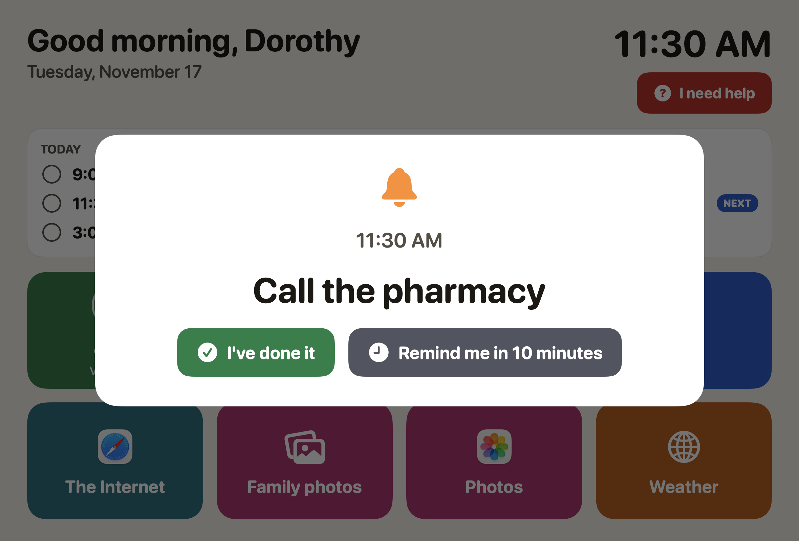 | 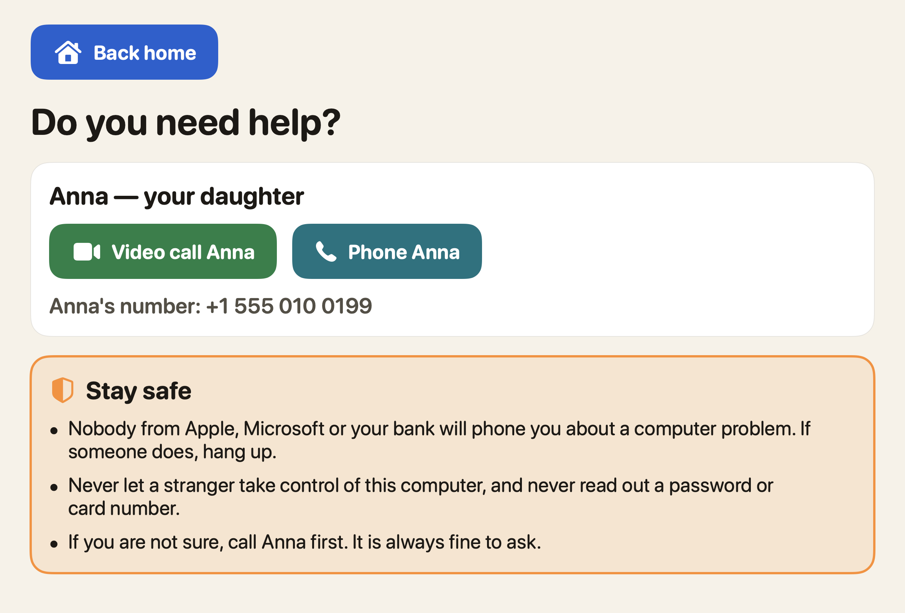 |

| Largest text | Dark | High contrast |
|:---:|:---:|:---:|
| 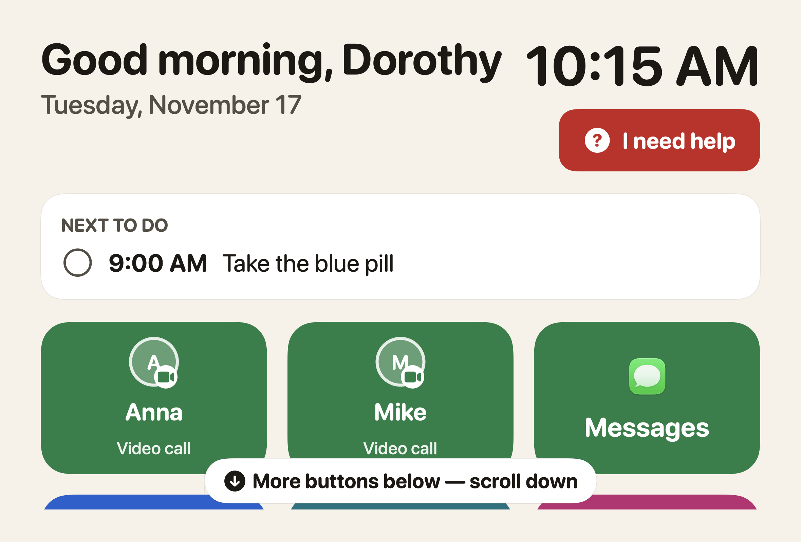 | 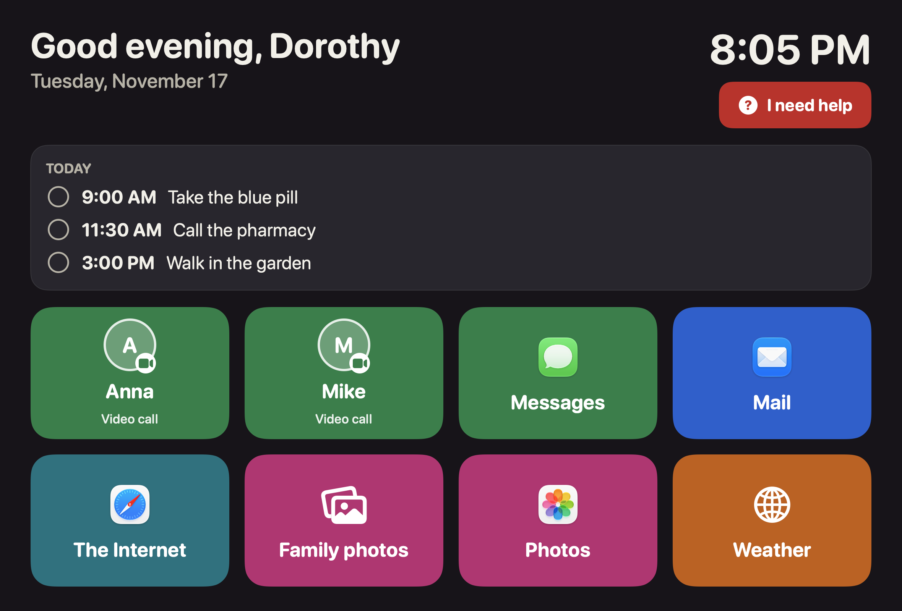 | 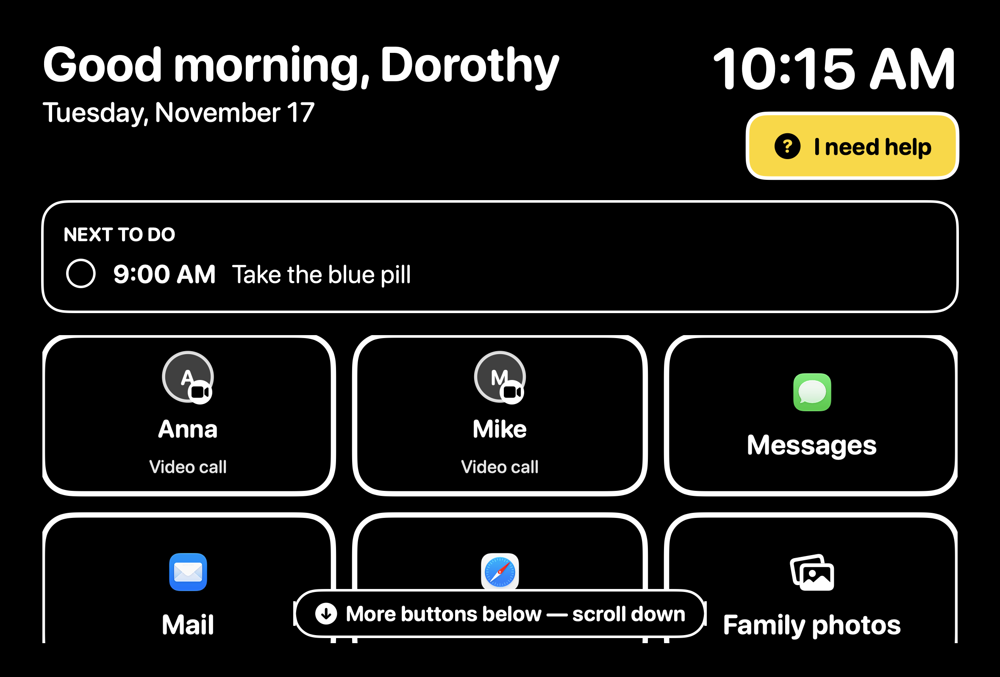 |

| Family photos | Caregiver settings | First-time setup |
|:---:|:---:|:---:|
| 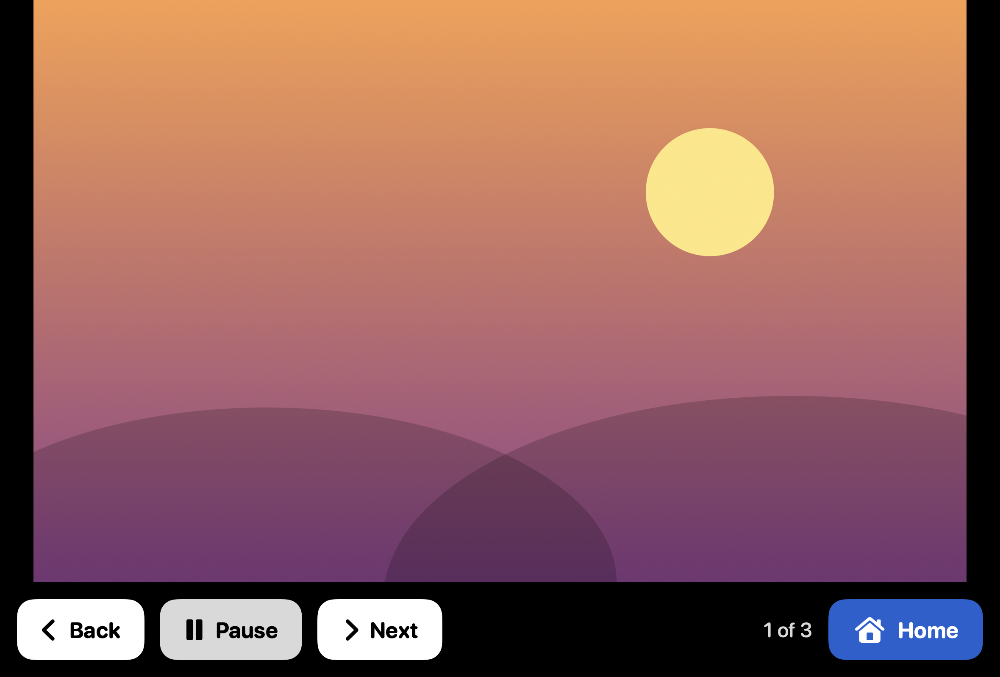 | 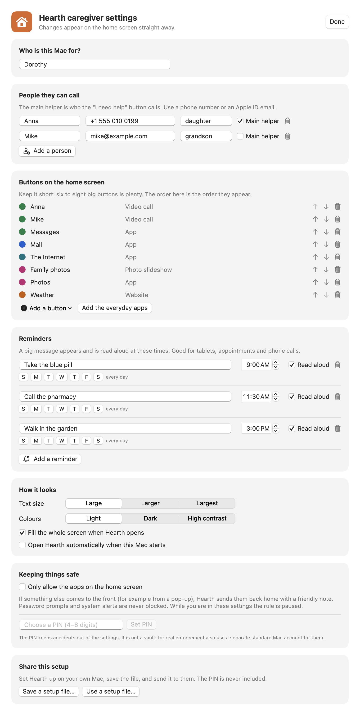 | 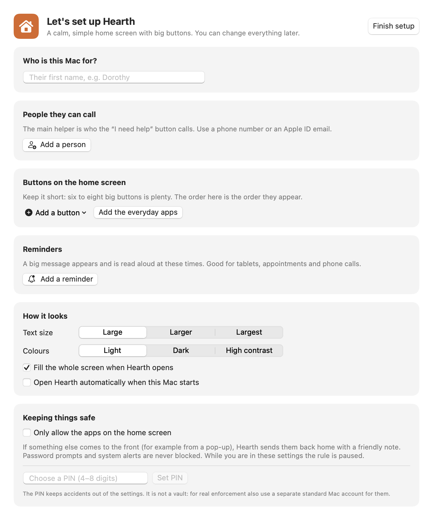 |

| PIN | After a reminder | Home / Help bar |
|:---:|:---:|:---:|
| 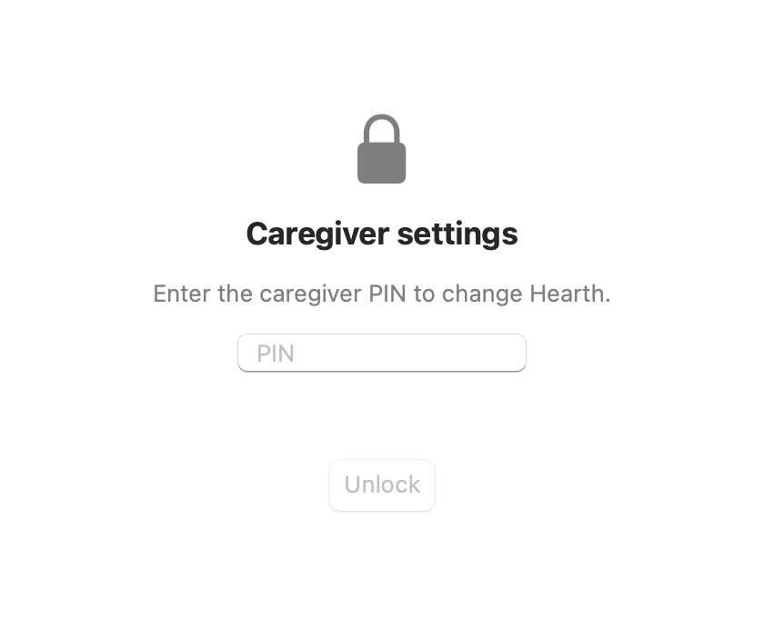 |  |  |

<sub>Screenshots and the demo are rendered by the app itself with made-up people and sample photos, so no personal information appears in them.</sub>

## Requirements

- **macOS 14 Sonoma or later** (built and tested on macOS 27).
- **Apple silicon** Mac (M1 or newer).
- **FaceTime and Messages signed in** on that Mac for the call buttons.
- To build from source: the Xcode Command Line Tools. Full Xcode is not needed.

## Installation

### Option 1 — Download the app

1. Download **[Hearth.zip](https://github.com/PriyanshuGeTRekT/hearth-simple-mac-for-seniors/releases/latest/download/Hearth.zip)** from the latest release.
2. Unzip it and drag **Hearth.app** into your **Applications** folder.
3. Open Hearth. Because the app isn't notarized by Apple, macOS blocks the first launch:
   - open **System Settings › Privacy & Security**, scroll down and click **Open Anyway** next to Hearth, or
   - run this once in Terminal:
     ```bash
     xattr -dr com.apple.quarantine /Applications/Hearth.app
     ```
4. The first launch opens the caregiver setup. Continue with [Setting it up for someone](#setting-it-up-for-someone-about-10-minutes).

### Option 2 — Install with Homebrew

```bash
brew tap priyanshugetrekt/hearth https://github.com/PriyanshuGeTRekT/hearth-simple-mac-for-seniors
```

```bash
brew install --cask priyanshugetrekt/hearth/hearth
```

The first launch still needs **Open Anyway** (step 3 above).

### Option 3 — Build from source

1. Install the Command Line Tools if you don't have them:
   ```bash
   xcode-select --install
   ```
2. Clone the repository:
   ```bash
   git clone https://github.com/PriyanshuGeTRekT/hearth-simple-mac-for-seniors.git
   ```
3. Build the app:
   ```bash
   cd hearth-simple-mac-for-seniors && ./build.sh
   ```
4. Copy it into Applications and open it:
   ```bash
   ditto dist/Hearth.app /Applications/Hearth.app && open /Applications/Hearth.app
   ```

To check everything, run the built-in self-test (it renders every screen offscreen and checks each one):

```bash
dist/Hearth.app/Contents/MacOS/Hearth --selftest
```

### Uninstalling Hearth

Quit Hearth from its menu (enter the PIN), turn off **Open at login** first if you like, then move `/Applications/Hearth.app` and `~/Library/Application Support/Hearth` to the Trash.

## Setting it up for someone (about 10 minutes)

1. **Make them their own account.** *System Settings › Users & Groups › Add User › Standard.* A separate standard account is the only way to make a restriction real; Hearth's PIN and strict mode keep accidents out but are not a vault.
2. In that account, sign in to the **Apple Account**, open **FaceTime** and **Messages** once and sign in, and put the helper in Contacts.
3. Copy **Hearth.app** to Applications and open it. The first launch opens the setup screen: name · people (mark the main helper) · **Add the everyday apps** · reminders · text size · PIN.
4. Tick **Open Hearth automatically when this Mac starts** and press **Finish setup**. Hearth now fills the screen.
5. Optional: turn on **Only allow the apps on the home screen**, and hide the Dock in *System Settings › Desktop & Dock*.
6. To change anything later, press **⌘,** (or **Hearth › Caregiver Settings…**) and enter the PIN.

**Setting it up from far away?** Do steps 3–4 on your own Mac in Hearth's caregiver settings, choose **Save a setup file**, and send it. On their Mac choose **Use a setup file**, then set a PIN there.

**Forgot the PIN?** Force Quit Hearth (⌥⌘⎋), then delete `~/Library/Application Support/Hearth/config.json`. This also erases the setup; use your setup file to restore it.

## How the safety rules work

- The home window can't be closed or minimised; quitting needs the PIN once setup is finished.
- **Home hides** other apps (`NSRunningApplication.hide`); it never terminates them.
- Strict mode listens for apps coming to the front. It is **suspended while the caregiver is unlocked** (so you can reach System Settings), can be paused for 15 minutes, and never acts before setup is finished, so it can't lock anyone in.
- The allow-list is derived from the buttons (a FaceTime button allows FaceTime; a website button allows the default browser), so there is nothing extra to maintain.

## Privacy and safety

- **No network requests.** No analytics, no telemetry, no account, no cloud.
- The setup lives in one file on the Mac, `~/Library/Application Support/Hearth/config.json`.
- The PIN is stored as a salted hash, never in plain text, and is never written into setup files. Repeated wrong PINs lock the prompt for a while.
- Setup files are treated as untrusted: every link and number is validated before anything is saved.
- The source is small and readable. Check it yourself.

## Known limitations

- **It is not a security boundary.** Someone determined, with access to the account, can edit the config file or Force Quit. For real enforcement use a separate standard account (and Screen Time if you want).
- **The apps Hearth opens are the real apps** (Mail, Safari…) with their full interface. Hearth simplifies *getting to* them and *getting back*; it doesn't re-skin them.
- **Reminders only run while Hearth is running.** It starts at login if you tick that box. If the Mac was asleep, a reminder shows on wake only if it came due within the last 3 hours.
- **FaceTime and iMessage must already be set up**; Hearth just opens the call.
- **Not notarized.** The download needs the one-time "Open Anyway" step. Building from source avoids it.

## FAQ

### Is there Assistive Access for Mac?
Apple's Assistive Access is only on iPhone and iPad. Hearth brings the same idea to the Mac: a simplified home screen with big buttons that a family member sets up.

### How do I make a Mac easier for an elderly parent?
Create a standard user account for them, install Hearth, add the people they call, the apps they use and their reminders, set a PIN and turn on **Open at login**. Hearth then fills the screen with big buttons, and a Home button floats above every app.

### Can my parent video call me with one click?
Yes. Each person gets a big button that starts a FaceTime video call. FaceTime must be signed in on that Mac.

### Can I set it up remotely?
Prepare the setup on your own Mac, choose **Save a setup file** and send it. On their Mac choose **Use a setup file**. The PIN is never included.

### Does Hearth stop scams?
It helps: the Help screen explains the usual phone scams, and strict mode keeps unknown apps from coming to the front. For a shield against remote-control scam apps such as AnyDesk and TeamViewer, pair it with [Warden](https://github.com/PriyanshuGeTRekT/warden-mac-safety-check-scam-shield), which also reads Hearth's main helper for its "Call your helper" button.

### Does it work for someone with dementia or low vision?
Hearth was designed with both in mind: few choices, plain labels, large text, high contrast, reminders read aloud, and no way to lose work. Every person is different, so try it together first.

### Why does macOS say Hearth cannot be opened?
Hearth is not notarized by Apple, so macOS blocks the first launch. Open **System Settings › Privacy & Security**, scroll down and click **Open Anyway** next to Hearth. You only need to do this once.

### Is Hearth free?
Yes. Hearth is free and open source under the MIT License, with no account, analytics or network requests.

## Roadmap

- Notarized builds
- Spoken buttons (read the label aloud on hover)
- Photos from a shared iCloud album
- More languages

Ideas and bug reports are welcome in [Issues](https://github.com/PriyanshuGeTRekT/hearth-simple-mac-for-seniors/issues). See the [changelog](CHANGELOG.md) for what's new in each release.

## Contributing

See [CONTRIBUTING.md](CONTRIBUTING.md). In short: fork, build with `./build.sh`, run `./scripts/test.sh` and `--selftest` before and after your change, and open a pull request. Security issues: see [SECURITY.md](SECURITY.md).

```bash
./scripts/test.sh                                   # unit tests: links, setup-file checks, PIN lockout, reminders, strict mode
dist/Hearth.app/Contents/MacOS/Hearth --render /tmp/screens   # PNGs of every screen
dist/Hearth.app/Contents/MacOS/Hearth --windowed    # run without filling the screen (safe while developing)
```

Project layout:

```
Sources/
├── HearthCore/   Every rule, UI-free and unit-tested (model, reminders, setup files, PIN, strict mode)
└── Hearth/       SwiftUI views and the AppKit shell (windows, floating bar, PIN-gated quit)
Tests/            Unit tests (Swift Testing)
docs/             Website (GitHub Pages), screenshots, demo
Casks/            Homebrew cask
```

## Star history

If Hearth makes a Mac easier for someone you love, a ⭐ star helps other families find it.

[](https://star-history.com/#PriyanshuGeTRekT/hearth-simple-mac-for-seniors&Date)

## License

[MIT](LICENSE) © 2026 [Priyanshu Yadav](https://github.com/PriyanshuGeTRekT)

<div align="center">
<sub><b>Hearth</b> — free simple Mac for seniors: Assistive Access for Mac, simplified Mac interface for elderly parents and grandparents, big-button launcher, one-click FaceTime video call, medication reminders read aloud, help button, scam warnings, caregiver PIN, kiosk-style strict mode, accessibility for low vision and dementia on Apple silicon Macs.</sub>
</div>
